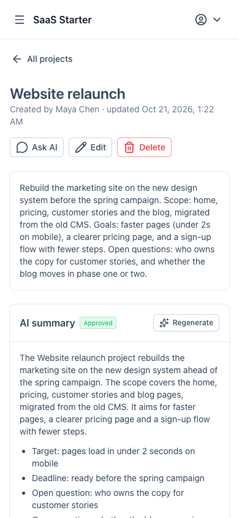

# SaaS Starter

A multi-organization SaaS starter: a **Laravel API** (`api/`) and a **Nuxt app** (`web/`).

Users sign up, belong to several organizations with a role (Owner, Admin, Member, or custom roles built from a list of permissions), switch between them, invite teammates by email, and manage organization-owned data, starting with Projects. Projects get AI summaries (Claude) that a teammate reviews before they count, and AI writing help in the project form (improve, expand or shorten the description, streamed as it's written, then accepted or discarded), plus a private AI chat about each project. An audit log records who did what in each organization. Each organization's data is isolated on the server: the active organization comes from the logged-in user, never from the request.

## Stack

| | |
|---|---|
| API | Laravel 13, PHP 8.4, PostgreSQL, Sanctum (Bearer tokens), Pest |
| Web | Nuxt 4, Nuxt UI 4, Pinia, TypeScript |

**Requirements:**
- **PHP 8.4+** (Pest 5 needs it), with the `pdo_pgsql` extension, and Composer.
- **Node 22.22.3+.** The version is in `web/.nvmrc`; run `nvm use` in `web/`.
- **PostgreSQL** running locally.

## Setup

### 1. Databases
Create two databases: one for the app, and one for the tests (the tests wipe theirs).
```bash
createdb -h 127.0.0.1 -U postgres saas_starter
createdb -h 127.0.0.1 -U postgres saas_starter_test
```

### 2. API
```bash
cd api
composer install
cp .env.example .env        # then set DB_* to match your Postgres
php artisan key:generate
php artisan migrate
```
Key settings in `api/.env`:

| Key | Default | What it's for |
|---|---|---|
| `DB_DATABASE`, `DB_USERNAME`, `DB_PASSWORD` | `saas_starter`, `postgres`, empty | The app database |
| `FRONTEND_URL` | `http://localhost:3000` | The only origin CORS allows, and the base of invitation links |
| `QUEUE_CONNECTION` | `database` | Invitation emails and AI summaries are queued |
| `MAIL_MAILER` | `log` | Locally, emails (with their invitation links) are written to `storage/logs/laravel.log` |
| `ANTHROPIC_API_KEY` | empty | Claude API key, used only by the API. Without it, summaries are marked failed |
| `AI_PROVIDER` | `anthropic` | `fake` returns canned summaries with no network calls (no key needed) |
| `AI_MODEL` | `claude-haiku-5-5` | Model for all AI features |
| `AI_RATE_LIMIT_PER_MINUTE` | `5` | AI requests per organization per minute |
| `AUDIT_RETENTION_DAYS` | `365` | Days to keep audit log entries; `0` keeps them forever |
| `BILLING_PROVIDER` | `stripe` | `fake` makes no Stripe calls: checkout goes straight back to the billing page and changes nothing |
| `STRIPE_KEY`, `STRIPE_SECRET` | empty | Stripe API keys (test mode locally), used only by the API |
| `STRIPE_WEBHOOK_SECRET` | empty | Signing secret of the webhook. Without it every webhook is refused, so subscriptions never sync |
| `STRIPE_PRICE_PRO` | empty | Price id of the recurring Pro price. Without it, upgrading is refused |
| `BILLING_PRO_AI_BUDGET_USD` | `50` | Monthly AI budget on Pro (Free gets `AI_MONTHLY_BUDGET_USD`) |
| `STRIPE_PRICE_CREDITS_10` | empty | Price id of the one-time "$10 of AI credits" price. Without it, buying credits is refused |

### Stripe (optional, for billing)
Billing uses [Laravel Cashier](https://laravel.com/docs/billing): the **organization** is the Stripe customer, payments happen on Stripe Checkout, and card changes, invoices and cancellation in the Stripe Customer Portal. Subscriptions reach the app only through the webhook.
1. In the Stripe Dashboard (test mode), create a product "Pro" with a recurring price and a product "AI credits" with a one-time $10 price; put their ids in `STRIPE_PRICE_PRO` and `STRIPE_PRICE_CREDITS_10`, and the API keys in `STRIPE_KEY` / `STRIPE_SECRET`.
2. Turn on the Customer Portal (Settings > Billing > Customer portal) and allow canceling subscriptions (at the end of the billing period) and updating payment methods. Leave switching plans off: the app only knows the prices in `config/billing.php`. Under Settings > Billing > Subscriptions, set what happens after all retries for a failed payment fail to "cancel the subscription" (Pro stays active while Stripe retries).
3. Forward webhooks locally with the [Stripe CLI](https://docs.stripe.com/stripe-cli) and put the `whsec_...` it prints in `STRIPE_WEBHOOK_SECRET`:
   ```bash
   stripe listen --forward-to localhost:8000/api/stripe/webhook \
     --events customer.subscription.created,customer.subscription.updated,customer.subscription.deleted,customer.updated,customer.deleted,payment_method.automatically_updated,invoice.payment_action_required,invoice.payment_succeeded,checkout.session.completed,checkout.session.async_payment_succeeded
   ```
   In production, add an endpoint for `https://<api>/api/stripe/webhook` with the same events and use its signing secret. (`php artisan cashier:webhook` registers Cashier's default events only, without the two `checkout.session.*` ones that grant credits.)
4. Pay with the test card `4242 4242 4242 4242`, any future date and any CVC.

Without Stripe, set `BILLING_PROVIDER=fake`; every organization stays on Free.

### 3. Web
```bash
cd web
nvm use
npm ci
cp .env.example .env        # NUXT_PUBLIC_API_BASE=http://localhost:8000
```

## Run

You need three terminals:
```bash
cd api && PHP_CLI_SERVER_WORKERS=4 php artisan serve --no-reload   # API on http://localhost:8000
cd api && php artisan queue:work     # sends queued emails and generates AI summaries
cd web && npm run dev                # app on http://localhost:3000
```
The API needs several workers: a streamed AI answer (writing help, chat) keeps one busy until it finishes. `--no-reload` is required for workers, so restart it after changing `.env`.
In production also run the scheduler (`php artisan schedule:work`, or a cron entry for `schedule:run`); it prunes old audit log entries daily.
Open http://localhost:3000 and register; your first organization is created for you.

## Tests and checks
Run everything with one command, from the repo root (it finds PHP 8.4 and the right Node version for you):
```bash
.claude/skills/verify/verify.sh          # or: verify.sh api | verify.sh web
```
Or run each step yourself:
```bash
cd api && php artisan test           # Pest, against saas_starter_test
cd api && vendor/bin/pint --test app routes tests database config bootstrap/app.php bootstrap/providers.php
cd web && npm run lint && npm run typecheck && npm run build
```
Every tenant-owned feature has a test proving organization A can't read or write organization B's data.

## Features so far

| Feature | API | Web |
|---|---|---|
| Register, log in, log out, current user | `POST /api/register`, `/login`, `/logout`, `GET /api/me` | `/register`, `/login` |
| Organizations: list, create, switch | `GET/POST /api/organizations`, `POST /api/organizations/{id}/switch` | Org switcher in the sidebar |
| Members: list, change role, remove (at least one owner always remains) | `GET/PATCH/DELETE /api/members` | `/members` |
| Roles: per-organization roles with permissions; create, edit, delete (not the built-in Owner, nor a role in use). People can only grant what they have | `GET/POST/PATCH/DELETE /api/roles`, `GET /api/permissions` | `/roles` |
| Invitations by email: invite, revoke, accept | `GET/POST/DELETE /api/invitations`, `GET/POST /api/join/{token}` | `/members`, `/join/{token}` |
| Projects: list with search and pagination (view, edit and delete from each row), create, edit, delete | `/api/projects` (REST) | `/projects`, `/projects/{id}` |
| Audit log: member, invitation, role, project and AI summary changes with who, when, IP and before/after values. Needs the "View the audit log" permission (Owner and Admin by default), which shows names and changes of everything audited (project names and changes only to those who can view projects); IP addresses are shown to owners only. Behind a load balancer, configure trusted proxies so the real client IP is recorded; filter by action, person and date; pruned after `AUDIT_RETENTION_DAYS` | `GET /api/audit-logs`, `GET /api/audit-log/actions` | `/audit-log` |
| AI project summaries: generated on create (or on request) as a draft, then approved (optionally after editing the text and key points) or rejected. A summary is flagged when the project's name or description changed since it was written (nothing regenerates on its own). Rate limited per organization; every AI call is recorded in `ai_usage` with tokens and cost. To summarize existing projects that never had one: `php artisan ai:summarize-projects` (`--organization=ID` to repeat, `--limit=50` in total, `--dry-run`). It only summarizes projects whose creator is still a member allowed to use AI, and skips an organization whose budget is already spent; summaries queued past the budget fail when the worker runs them | `GET/POST /api/projects/{id}/summary`, `POST /api/projects/{id}/summaries/{summaryId}/approve`, `/reject` | AI summary card on `/projects/{id}` |
| AI writing help: "Improve with AI" under a project's description improves, expands or shortens it. The answer streams in as it's written (server-sent events) and can be stopped, accepted into the form, retried or discarded; nothing is saved until the project is. Needs "Use AI features" plus create (new project) or edit (existing one); counts against the budget and rate limit | `POST /api/projects/writing-help`, `POST /api/projects/{id}/writing-help` (`text/event-stream`) | Project create and edit forms |
| Project chat: "Ask AI" on a project opens a chat about that project (its name, description and approved summary). Answers stream in and can be stopped; the conversation is saved per user and only they see it; they can clear it, and it's deleted when they leave the organization. The AI can't change anything. Needs "Use AI features" plus view projects; counts against the budget and rate limit | `GET`, `POST` (`text/event-stream`), `DELETE /api/projects/{id}/chat` | Project page |
| AI usage and budget: calls, tokens and cost by feature, person and day for a month ("View AI usage and cost", Admin by default). A monthly budget per organization (its plan's: `AI_MONTHLY_BUDGET_USD`, default $5, on Free, `BILLING_PRO_AI_BUDGET_USD` on Pro, plus AI credits bought that month; owners can lower theirs, 0 turns AI off) blocks AI requests once used up. Using AI needs the "Use AI features" permission (Admin and Member by default) | `GET /api/ai-usage?month=YYYY-MM`, `PUT /api/ai-budget` | `/ai-usage` |
| Billing: Free and Pro plans per organization, Pro raising the monthly AI budget. Upgrading opens Stripe Checkout; the Customer Portal changes the card, shows invoices and cancels (Pro stays until the paid period ends, and while Stripe retries a failed renewal). Plans come from `config/billing.php`; only the webhook changes a subscription, and plan changes are audited. AI credits: a one-time $10 pack (Stripe Checkout) adds to the AI budget for the rest of that UTC month, on any plan; granted once per paid checkout, and audited. Needs "Manage the plan, payment details and invoices" (Owner only by default) | `GET /api/billing`, `POST /api/billing/checkout`, `POST /api/billing/credits/checkout`, `POST /api/billing/portal`, `POST /api/stripe/webhook` (Stripe-signed) | `/billing` |

Organization routes act on the user's **current** organization (`users.current_organization_id`). Tenant-owned models use the `BelongsToOrganization` trait, so another organization's records return 404.

## Screenshots

Demo data with real Claude answers (Haiku), light mode.

### Projects and AI

**Projects** in the current organization, with who created them.


**AI summary**, approved by a teammate before it shows as the project's summary.


**Writing help** streams a better description into the form; accept, retry or discard it.


**Ask AI**: a private chat about the project, streamed as it's written.


### Team and admin

**Members** and pending invitations, with a role per person.


**Roles** built from permissions; Owner is built in.


**Permissions** a role grants, picked from a grouped list. Policies check these, never role names.


**Audit log** of who did what, with filters.


**AI usage** against the monthly budget, by feature and person.


**Billing**: Free and Pro plans (Stripe Checkout and Customer Portal) and one-time AI credits.


**Mobile**: the sidebar collapses into a menu.



## Project layout
```
api/            Laravel API (Actions, Policies, Form Requests, Resources, Pest tests)
web/app/        Nuxt app (pages, components, Pinia stores, useApi composable)
docs/plans/     One plan per task, with status (Proposed → WIP → Done) and commit hashes
CLAUDE.md       Conventions and rules for working on this repo (also used by Claude Code)
.claude/        Claude Code skills, review agents and settings
```

## Contributing
Read [CLAUDE.md](CLAUDE.md) for conventions: thin controllers, Actions, Form Requests, organization isolation, and docs updated in the same commit as the code they describe. Then see [docs/plans/](docs/plans/README.md) for how the project was built, task by task, including known follow-ups.
